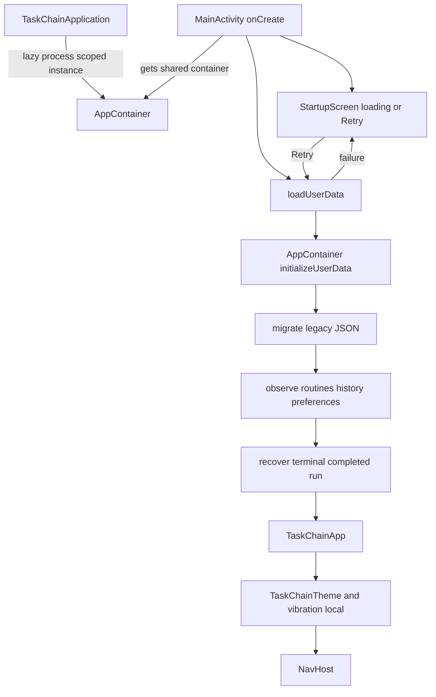
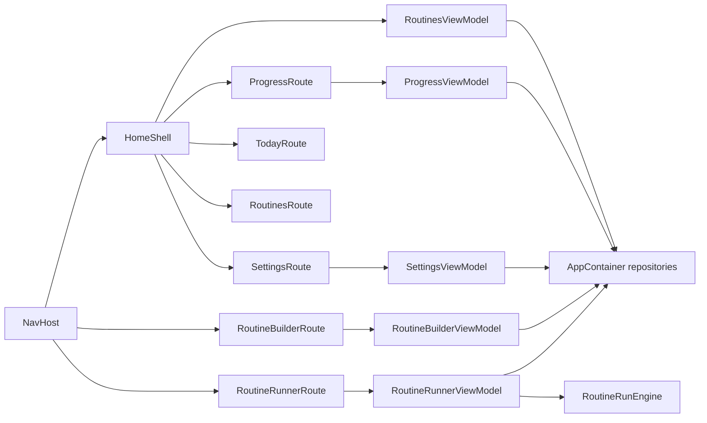
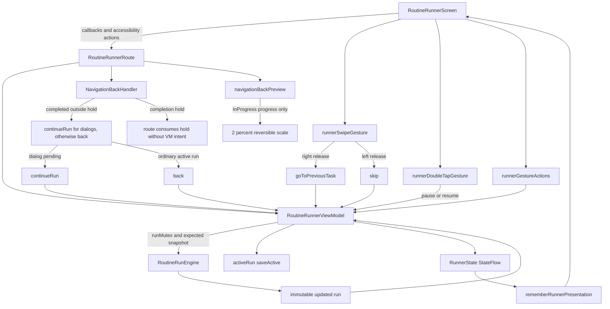
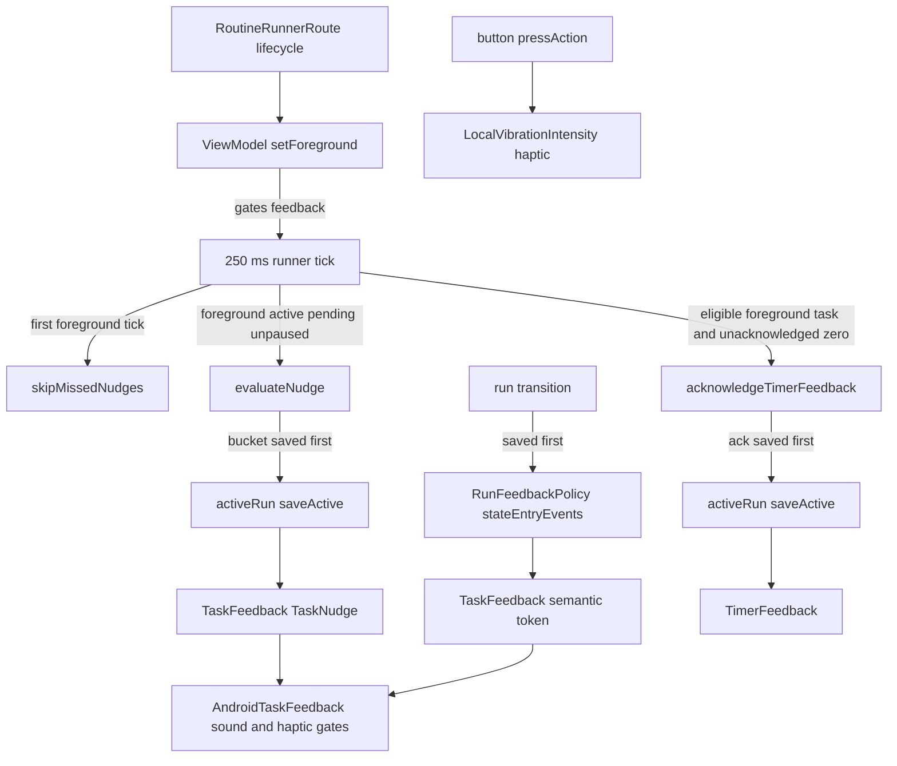
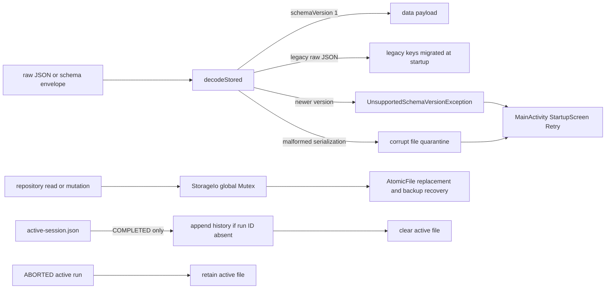
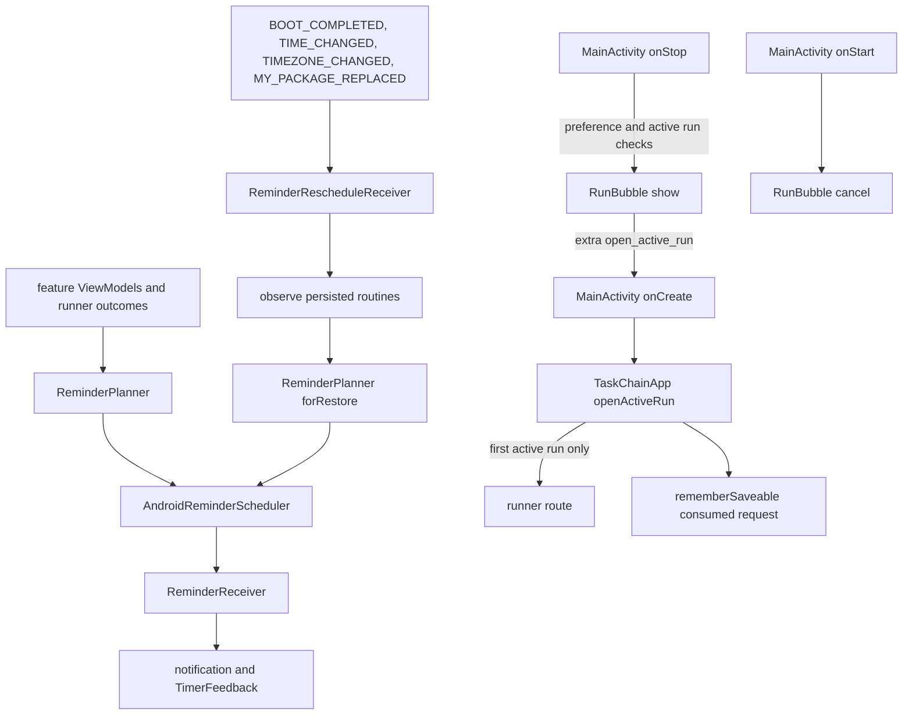

# TaskChain UI wiring — `refactor-feature-integration`

This reference is for developers tracing the app-owned Compose routes, their
ViewModels, persistence, runner effects, and Android lifecycle entry points.
It describes the source at pinned commit
[`90fee1e8c5fa1e5765c18b51c28ea9806c5b8671`](https://github.com/matthewdmanning/TaskChain/tree/90fee1e8c5fa1e5765c18b51c28ea9806c5b8671).
Use [`architecture.md`](../../architecture.md) for package boundaries and
[`docs/on-device-data.md`](../on-device-data.md) for the durable-data contract;
this page links to those authorities instead of restating their domain rules.

The companion [actions reference](TaskChain-UI-Actions-refactor-feature-integration.md)
and [action index](TaskChain-UI-Action-Index-refactor-feature-integration.jsonl)
remain historical artifacts from their recorded source snapshot. Do not use
their old source anchors as the current call graph.

The method is static source inspection. The diagrams show call, state, and
effect wiring; they do not claim device, gesture, reboot, or upgrade execution.
CyberpunkAndroid and Material internals are external dependencies and stay
outside this map.

## Startup and application composition

`TaskChainApplication` owns one lazy `AppContainer` for the process. `MainActivity`
shows `StartupScreen` until `loadUserData` completes
`AppContainer.initializeUserData`; a storage failure keeps editable screens
hidden and **Retry** invokes the same loader. Initialization migrates legacy
JSON, opens the routine, completion, and preference flows, and recovers an
interrupted completed run before the app exposes routes.

Sources: [`TaskChainApplication.kt:5–8`](https://github.com/matthewdmanning/TaskChain/blob/90fee1e8c5fa1e5765c18b51c28ea9806c5b8671/app/src/main/java/com/taskchain/TaskChainApplication.kt#L5-L8), [`AppContainer.kt:32–66`](https://github.com/matthewdmanning/TaskChain/blob/90fee1e8c5fa1e5765c18b51c28ea9806c5b8671/app/src/main/java/com/taskchain/AppContainer.kt#L32-L66), [`MainActivity.kt:18–58`](https://github.com/matthewdmanning/TaskChain/blob/90fee1e8c5fa1e5765c18b51c28ea9806c5b8671/app/src/main/java/com/taskchain/MainActivity.kt#L18-L58), and [`StartupScreen.kt:21–41`](https://github.com/matthewdmanning/TaskChain/blob/90fee1e8c5fa1e5765c18b51c28ea9806c5b8671/app/src/main/java/com/taskchain/ui/StartupScreen.kt#L21-L41).

## Routes and feature ViewModels

`TaskChainApp` owns the three navigation destinations and the saveable selected
tab value. `HomeShell` receives that value and its selection, create, edit,
start, and resume callbacks; it constructs the home, progress, and settings
ViewModels. `RoutinesViewModel`
mediates the active-run start conflict. The builder, progress, settings, and
runner each have a route and a package-local ViewModel; screens render state and
emit callbacks into those owners.

Sources: [`TaskChainApp.kt:40–116`](https://github.com/matthewdmanning/TaskChain/blob/90fee1e8c5fa1e5765c18b51c28ea9806c5b8671/app/src/main/java/com/taskchain/ui/TaskChainApp.kt#L40-L116), [`HomeScreen.kt:95–171`](https://github.com/matthewdmanning/TaskChain/blob/90fee1e8c5fa1e5765c18b51c28ea9806c5b8671/app/src/main/java/com/taskchain/ui/home/HomeScreen.kt#L95-L171), [`RoutinesViewModel.kt:30–98`](https://github.com/matthewdmanning/TaskChain/blob/90fee1e8c5fa1e5765c18b51c28ea9806c5b8671/app/src/main/java/com/taskchain/ui/home/RoutinesViewModel.kt#L30-L98), [`RoutineBuilderRoute.kt:119–178`](https://github.com/matthewdmanning/TaskChain/blob/90fee1e8c5fa1e5765c18b51c28ea9806c5b8671/app/src/main/java/com/taskchain/ui/builder/RoutineBuilderRoute.kt#L119-L178), [`RoutineBuilderViewModel.kt:285–340`](https://github.com/matthewdmanning/TaskChain/blob/90fee1e8c5fa1e5765c18b51c28ea9806c5b8671/app/src/main/java/com/taskchain/ui/builder/RoutineBuilderViewModel.kt#L285-L340), [`ProgressRoute.kt:32–50`](https://github.com/matthewdmanning/TaskChain/blob/90fee1e8c5fa1e5765c18b51c28ea9806c5b8671/app/src/main/java/com/taskchain/ui/progress/ProgressRoute.kt#L32-L50), [`ProgressViewModel.kt:15–23`](https://github.com/matthewdmanning/TaskChain/blob/90fee1e8c5fa1e5765c18b51c28ea9806c5b8671/app/src/main/java/com/taskchain/ui/progress/ProgressViewModel.kt#L15-L23), [`SettingsRoute.kt:47–78`](https://github.com/matthewdmanning/TaskChain/blob/90fee1e8c5fa1e5765c18b51c28ea9806c5b8671/app/src/main/java/com/taskchain/ui/settings/SettingsRoute.kt#L47-L78), and [`SettingsViewModel.kt:13–50`](https://github.com/matthewdmanning/TaskChain/blob/90fee1e8c5fa1e5765c18b51c28ea9806c5b8671/app/src/main/java/com/taskchain/ui/settings/SettingsViewModel.kt#L13-L50).

## Runner state, gestures, and navigation events

`RoutineRunnerViewModel` serializes transitions with `runMutex`, checks the
acted-on task and confirmation flags against the current snapshot, persists
ordinary transitions, and sends terminal completed runs through history before
clearing the active file. `RoutineRunnerRoute` observes lifecycle foreground
state, derives timer and subtask presentation values, and holds a completed
snapshot through the completion and ready phases before `onFinished` pops the
route.

The runner uses a right swipe to call `goToPreviousTask` and a left swipe to
call `skip`; the engine makes a right swipe on the first task a no-op. A double
tap on the main dial interior toggles pause or resume. Single taps remain
available to controls. The same previous, skip, and pause/resume actions are
exposed as accessibility custom actions.

`NavigationBackHandler` is enabled for an active run or while the completion
hold is visible. During the hold, completed Back is consumed without a
ViewModel intent. Outside the hold, a pending finish or abort dialog is closed
through `continueRun`; otherwise the ViewModel receives `back`. The
`navigationBackPreview` modifier reads only
`NavigationEventTransitionState.InProgress.latestEvent.progress` and applies a
reversible two-percent scale. It is gated by the route's animation settings,
dialog state, and the Android animator setting. The modifier is the graphics
seam for a future fade or wipe; it does not change domain or navigation state
until Back completes. If the Back gesture is cancelled, `onBackCompleted` does
not run and the ViewModel receives no transition.

Sources: [`RoutineRunnerRoute.kt:118–205`](https://github.com/matthewdmanning/TaskChain/blob/90fee1e8c5fa1e5765c18b51c28ea9806c5b8671/app/src/main/java/com/taskchain/ui/runner/RoutineRunnerRoute.kt#L118-L205), [`RoutineRunnerViewModel.kt:32–132`](https://github.com/matthewdmanning/TaskChain/blob/90fee1e8c5fa1e5765c18b51c28ea9806c5b8671/app/src/main/java/com/taskchain/ui/runner/RoutineRunnerViewModel.kt#L32-L132), [`RunnerGestures.kt:49–195`](https://github.com/matthewdmanning/TaskChain/blob/90fee1e8c5fa1e5765c18b51c28ea9806c5b8671/app/src/main/java/com/taskchain/ui/runner/RunnerGestures.kt#L49-L195), [`NavigationBackPreview.kt:15–37`](https://github.com/matthewdmanning/TaskChain/blob/90fee1e8c5fa1e5765c18b51c28ea9806c5b8671/app/src/main/java/com/taskchain/ui/NavigationBackPreview.kt#L15-L37), [`RunPresentation.kt:33–120`](https://github.com/matthewdmanning/TaskChain/blob/90fee1e8c5fa1e5765c18b51c28ea9806c5b8671/app/src/main/java/com/taskchain/ui/runner/RunPresentation.kt#L33-L120), and [`RoutineRunEngine.kt:230–425`](https://github.com/matthewdmanning/TaskChain/blob/90fee1e8c5fa1e5765c18b51c28ea9806c5b8671/app/src/main/java/com/taskchain/domain/run/RoutineRunEngine.kt#L230-L425).

The builder uses its own `NavigationBackHandler` and the same preview modifier.
Completed Back calls `requestClose`: a changed draft opens the discard dialog,
and a clean draft invokes `onClose`. Preview is disabled while the discard
dialog is shown; cancellation does not run `requestClose`.
## Runner feedback and lifecycle gates

The runner route updates foreground state from lifecycle events. On the first
foreground tick, it advances missed nudge buckets without replaying them. On a
250 ms tick, an eligible active pending task passes through
`RunFeedbackPolicy.evaluateNudge`; the bucket is persisted before a
`TaskFeedback` nudge fires. A zero countdown is acknowledged and persisted
before `TimerFeedback` fires. Ordinary persisted transitions produce semantic
state-entry events through `RunFeedbackPolicy`, then dispatch them through the
same task-feedback adapter. Button press haptics use `pressAction` and the
`LocalVibrationIntensity` composition local; they are a separate path.

Sources: [`RoutineRunnerRoute.kt:130–149`](https://github.com/matthewdmanning/TaskChain/blob/90fee1e8c5fa1e5765c18b51c28ea9806c5b8671/app/src/main/java/com/taskchain/ui/runner/RoutineRunnerRoute.kt#L130-L149), [`RoutineRunnerViewModel.kt:150–215`](https://github.com/matthewdmanning/TaskChain/blob/90fee1e8c5fa1e5765c18b51c28ea9806c5b8671/app/src/main/java/com/taskchain/ui/runner/RoutineRunnerViewModel.kt#L150-L215), [`RoutineRunnerViewModel.kt:297–318`](https://github.com/matthewdmanning/TaskChain/blob/90fee1e8c5fa1e5765c18b51c28ea9806c5b8671/app/src/main/java/com/taskchain/ui/runner/RoutineRunnerViewModel.kt#L297-L318), [`RoutineRunnerViewModel.kt:332–339`](https://github.com/matthewdmanning/TaskChain/blob/90fee1e8c5fa1e5765c18b51c28ea9806c5b8671/app/src/main/java/com/taskchain/ui/runner/RoutineRunnerViewModel.kt#L332-L339), [`RunFeedbackPolicy.kt:24–143`](https://github.com/matthewdmanning/TaskChain/blob/90fee1e8c5fa1e5765c18b51c28ea9806c5b8671/app/src/main/java/com/taskchain/domain/run/RunFeedbackPolicy.kt#L24-L143), [`TaskFeedback.kt:13–98`](https://github.com/matthewdmanning/TaskChain/blob/90fee1e8c5fa1e5765c18b51c28ea9806c5b8671/app/src/main/java/com/taskchain/reminder/TaskFeedback.kt#L13-L98), and [`PressFeedback.kt:13–66`](https://github.com/matthewdmanning/TaskChain/blob/90fee1e8c5fa1e5765c18b51c28ea9806c5b8671/app/src/main/java/com/taskchain/ui/PressFeedback.kt#L13-L66).

## Local storage and terminal recovery

The persisted data layout and migration policy belong to
[`docs/on-device-data.md`](../on-device-data.md). The wiring relevant to UI
startup and runner recovery is:

Current JSON records use `{"schemaVersion":1,"data":...}`. Legacy raw
payloads and renamed step/cue keys are migrated under the same process-wide
`StorageIo.mutex`. `AtomicFile` supplies replacement and `.bak` recovery; it is
not the lock. Serialization failures are quarantined as `.corrupt-*` files with
rename success checked. An unsupported schema version raises
`UnsupportedSchemaVersionException`, so it is neither replaced nor quarantined;
the startup loader withholds editable screens and offers **Retry**.

`recoverTerminalSession` repairs only an interrupted `COMPLETED` history write:
it appends the event when the run ID is absent, then clears the active file.
An `ABORTED` run remains in `active-session.json` and is not moved to history by
this recovery path.

Sources: [`StoredJson.kt:11–79`](https://github.com/matthewdmanning/TaskChain/blob/90fee1e8c5fa1e5765c18b51c28ea9806c5b8671/app/src/main/java/com/taskchain/data/StoredJson.kt#L11-L79), [`FileRepositories.kt:25–58`](https://github.com/matthewdmanning/TaskChain/blob/90fee1e8c5fa1e5765c18b51c28ea9806c5b8671/app/src/main/java/com/taskchain/data/FileRepositories.kt#L25-L58), [`FileRepositories.kt:67–202`](https://github.com/matthewdmanning/TaskChain/blob/90fee1e8c5fa1e5765c18b51c28ea9806c5b8671/app/src/main/java/com/taskchain/data/FileRepositories.kt#L67-L202), [`LegacyJsonMigration.kt:31–71`](https://github.com/matthewdmanning/TaskChain/blob/90fee1e8c5fa1e5765c18b51c28ea9806c5b8671/app/src/main/java/com/taskchain/data/LegacyJsonMigration.kt#L31-L71), [`RunRecovery.kt:4–18`](https://github.com/matthewdmanning/TaskChain/blob/90fee1e8c5fa1e5765c18b51c28ea9806c5b8671/app/src/main/java/com/taskchain/data/RunRecovery.kt#L4-L18), and [`on-device-data.md`](../on-device-data.md).

## Reminders, boot restoration, and active-run bubbles

The reminder scheduler carries recurrence data in each alarm intent. Delivery
uses `ReminderReceiver`; restoration listens for boot, clock, time-zone, and
package-replaced broadcasts, reads persisted routines, and schedules the
`ReminderPlanner.forRestore` result. The restoration receiver does not run the
startup migration or terminal recovery path, and its broad exception guard
prevents a damaged or concurrently replaced routine file from crashing a
system broadcast. Pre-unlock reminders are outside the current contract.

When the activity stops, `MainActivity` shows a bubble only when the user opted
in, the stored run is active, and Android permits bubbles. The bubble launches
`MainActivity` with `open_active_run`; `TaskChainApp` waits for an active run,
navigates once, and records the consumed request with `rememberSaveable`. On
activity start, the bubble is cancelled unless the activity itself was launched
from that bubble.

Sources: [`ReminderScheduler.kt:39–113`](https://github.com/matthewdmanning/TaskChain/blob/90fee1e8c5fa1e5765c18b51c28ea9806c5b8671/app/src/main/java/com/taskchain/reminder/ReminderScheduler.kt#L39-L113), [`ReminderScheduler.kt:115–224`](https://github.com/matthewdmanning/TaskChain/blob/90fee1e8c5fa1e5765c18b51c28ea9806c5b8671/app/src/main/java/com/taskchain/reminder/ReminderScheduler.kt#L115-L224), [`ReminderScheduler.kt:226–255`](https://github.com/matthewdmanning/TaskChain/blob/90fee1e8c5fa1e5765c18b51c28ea9806c5b8671/app/src/main/java/com/taskchain/reminder/ReminderScheduler.kt#L226-L255), [`RunBubble.kt:26–50`](https://github.com/matthewdmanning/TaskChain/blob/90fee1e8c5fa1e5765c18b51c28ea9806c5b8671/app/src/main/java/com/taskchain/reminder/RunBubble.kt#L26-L50), [`RunBubble.kt:51–112`](https://github.com/matthewdmanning/TaskChain/blob/90fee1e8c5fa1e5765c18b51c28ea9806c5b8671/app/src/main/java/com/taskchain/reminder/RunBubble.kt#L51-L112), [`RunBubble.kt:154–190`](https://github.com/matthewdmanning/TaskChain/blob/90fee1e8c5fa1e5765c18b51c28ea9806c5b8671/app/src/main/java/com/taskchain/reminder/RunBubble.kt#L154-L190), [`MainActivity.kt:60–87`](https://github.com/matthewdmanning/TaskChain/blob/90fee1e8c5fa1e5765c18b51c28ea9806c5b8671/app/src/main/java/com/taskchain/MainActivity.kt#L60-L87), and [`TaskChainApp.kt:42–116`](https://github.com/matthewdmanning/TaskChain/blob/90fee1e8c5fa1e5765c18b51c28ea9806c5b8671/app/src/main/java/com/taskchain/ui/TaskChainApp.kt#L42-L116).

## Source lookup

All paths below are relative to `app/src/main/java/com/taskchain/`.

| Area | Entry point | Owner or boundary |
| --- | --- | --- |
| Application composition | `TaskChainApplication`, `AppContainer` | shared repositories and Android adapters |
| Startup and bubble lifecycle | `MainActivity` | startup gate, retry, bubble show/cancel |
| Navigation | `ui/TaskChainApp.kt` | `NavHost`, saveable tab and bubble request consumption |
| Home | `ui/home/HomeScreen.kt` | `HomeShell`, `RoutinesViewModel`, tab routes |
| Builder | `ui/builder/RoutineBuilderRoute.kt` | `RoutineBuilderViewModel`, validation and save intents |
| Progress | `ui/progress/ProgressRoute.kt` | `ProgressViewModel` and completion projection |
| Settings | `ui/settings/SettingsRoute.kt` | `SettingsViewModel` and preferences |
| Runner adapter | `ui/runner/RoutineRunnerRoute.kt` | lifecycle, navigation events, presentation and callbacks |
| Runner state | `ui/runner/RoutineRunnerViewModel.kt` | persistence, mutex, feedback dispatch, terminal recovery retry |
| Runner gestures | `ui/runner/RunnerGestures.kt` | right/left swipe, double tap, accessibility actions |
| Back preview | `ui/NavigationBackPreview.kt` | NavigationEvent progress to reversible graphics |
| Run rules | `domain/run/RoutineRunEngine.kt` | immutable run transitions and invariants |
| JSON storage | `data/StoredJson.kt`, `data/FileRepositories.kt` | envelopes, schema rejection, quarantine, atomic files |
| Reminder delivery | `reminder/ReminderScheduler.kt` | alarms, broadcast receivers, feedback |
| Active-run bubble | `reminder/RunBubble.kt` | Android notification and bubble permissions |

For domain semantics, schema layout, migration, update, and device-test
constraints, see [`architecture.md`](../../architecture.md) and
[`docs/on-device-data.md`](../on-device-data.md). This page has no runtime
verification evidence; gesture behavior, reboot restoration, and update
preservation require focused device tests.
